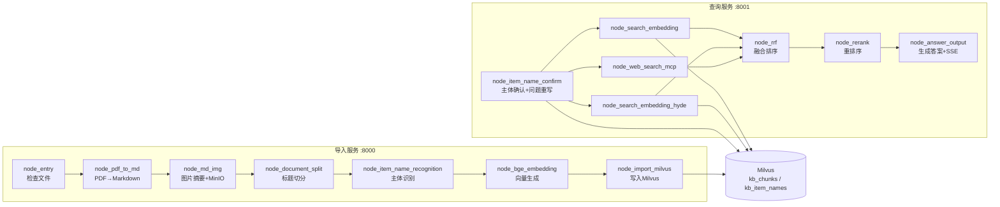

# KnowAgent · 知识库构建与问答智能体

一个基于 **LangGraph** 的 RAG 知识库系统：把 PDF / Markdown 文档自动解析成结构化切片，写入 **Milvus**；再基于用户问题做多路召回 + 重排序 + 大模型生成，返回带出处的答案。

项目提供两个独立服务：

- **导入服务**（`import_server`，:8000）—— 文件上传 → 解析 → 切分 → 向量化 → 入库
- **查询服务**（`query_server`，:8001）—— 问答，支持 **SSE 流式输出** 和阶段进度推送

---

## 目录

- [功能特性](#功能特性)
- [整体架构](#整体架构)
- [目录结构](#目录结构)
- [技术栈](#技术栈)
- [快速开始](#快速开始)
- [环境变量说明](#环境变量说明)
- [API 一览](#api-一览)
- [两条主流程](#两条主流程)
- [常见问题](#常见问题)
- [当前状态与限制](#当前状态与限制)
- [安全提醒](#安全提醒)

---

## 功能特性

- **文档导入**：PDF 走 MinerU 云端解析成 Markdown；Markdown 直接进入流程
- **图片处理**：调用多模态模型为图片生成摘要，图片上传 MinIO，并把 Markdown 中的本地图片替换成可访问 URL
- **智能切分**：按 Markdown 标题层级粗切 → 超长块二次切分 → 过短块合并，输出语义完整的 chunk
- **主体识别**：大模型从切片中识别“这份文档讲的是哪个商品/型号”，并把主体名称向量化入库，用于问题主体确认
- **混合检索**：BGE-M3 稠密向量 + 稀疏向量在 Milvus 中做混合检索（HNSW + SPARSE_INVERTED_INDEX）
- **多路召回**：向量检索 + HyDE 假设性文档检索 + 联网搜索（DashScope MCP）三路并行，RRF 融合后重排序
- **流式问答**：SSE 推送 `progress`（节点进度）/ `delta`（流式 token）/ `final`（最终答案 + 图片）
- **对话历史**：MongoDB 持久化，支持按会话查询与清空
- **可观测**：loguru 日志按天切分，节点级任务状态（running / done）实时可查

---

## 整体架构



外部依赖：**MinerU**（PDF 解析）、**OpenAI 兼容 LLM**、**BGE-M3 / BGE-Reranker**（本地模型）、**MinIO**、**Milvus**、**MongoDB**、**DashScope MCP WebSearch**（可选）。

---

## 目录结构

```
.
├── app
│   ├── clients/                 # 外部服务客户端（单例）
│   │   ├── milvus_utils.py      # Milvus：混合检索 / 批量查询
│   │   ├── minio_utils.py       # MinIO：桶初始化、公网只读策略
│   │   ├── mongo_history_utils.py  # MongoDB：会话历史
│   │   └── neo4j_utils.py       # Neo4j（预留，未接入图谱检索）
│   ├── conf/                    # 配置（dataclass + .env）
│   ├── core/
│   │   ├── logger.py            # loguru 日志（按天切分）
│   │   └── load_prompt.py       # 提示词模板加载与渲染
│   ├── lm/
│   │   ├── lm_utils.py          # LLM 客户端（OpenAI 兼容，带缓存）
│   │   ├── embedding_utils.py   # BGE-M3 稠密+稀疏向量
│   │   └── reranker_utils.py    # BGE-Reranker
│   ├── import_process/          # ── 导入流程 ──
│   │   ├── agent/
│   │   │   ├── main_graph.py    # LangGraph 导入主图
│   │   │   ├── state.py         # 导入状态定义
│   │   │   └── nodes/           # 7 个导入节点
│   │   ├── api/import_server.py # FastAPI 导入服务 (:8000)
│   │   └── page/import.html     # 导入页（原生 HTML）
│   ├── query_process/           # ── 查询流程 ──
│   │   ├── agent/
│   │   │   ├── main_graph.py    # LangGraph 查询主图
│   │   │   ├── state.py         # 查询状态定义
│   │   │   └── nodes/           # 7 个查询节点
│   │   ├── api/query_server.py  # FastAPI 查询服务 (:8001)
│   │   └── page/chat.html       # 聊天页（原生 HTML + EventSource）
│   ├── tools/                   # 模型下载脚本（ModelScope）
│   └── utils/                   # 各节点的业务工具函数
├── prompts/                     # 提示词模板（.prompt）
├── pyproject.toml               # 依赖（uv / PEP 621）
├── uv.lock
└── .env                         # 环境变量（不要提交，见“安全提醒”）
```

---

## 技术栈

| 类别 | 选型 |
|---|---|
| 编排 | LangGraph（StateGraph + 条件边 + 并行分支） |
| 服务 | FastAPI + Uvicorn，SSE（`StreamingResponse`） |
| 大模型 | OpenAI 兼容接口（默认 `deepseek-flash`），多模态模型用于图片摘要 |
| 向量模型 | BGE-M3（1024 维稠密 + 稀疏，本地加载） |
| 重排序 | BGE-Reranker-Large（本地加载） |
| 向量库 | Milvus（HNSW / SPARSE_INVERTED_INDEX，COSINE + IP） |
| 对象存储 | MinIO |
| 文档库 | MongoDB（会话历史） |
| PDF 解析 | MinerU 云端 API（`/api/v4`） |
| 联网检索 | DashScope MCP WebSearch（`bailian_web_search`） |
| 日志 | loguru（控制台 + 文件，按天切分/保留） |
| 依赖管理 | uv（Python 3.11） |

---

## 快速开始

### 1. 环境要求

- Python **3.11**
- 可访问的外部服务：
  - **MinIO**（存储文档图片，需可公网读或局域网可读）
  - **Milvus**（向量库）
  - **MongoDB**（会话历史）
  - **MinerU** 云端 API Token（[mineru.net](https://mineru.net)）
  - **OpenAI 兼容 LLM** 的 `base_url` + `api_key`
  - **DashScope** API Key（联网搜索 MCP，可选）
- 本地模型：**BGE-M3**、**BGE-Reranker-Large**（约 2GB+，需提前下载）

### 2. 安装依赖

```bash
# 推荐：uv
uv sync

# 或 pip
pip install -e .
```

### 3. 下载本地模型

```bash
python -m app.tools.download_bgem3
python -m app.tools.download_reranker
```

> 两个脚本里的 `cache_dir` 是示例路径，请按自己的磁盘修改；下载完成后把实际目录写回 `.env`：
>
> ```ini
> BGE_M3_PATH=D:\ai_models\modelscope_cache\models\models\BAAI--bge-m3\snapshots\master
> BGE_RERANKER_LARGE=D:\ai_models\modelscope_cache\models\rerank\models\BAAI--bge-reranker-large\snapshots\master
> BGE_DEVICE=cpu
> ```
>
> ⚠️ 两个注意点：
> 1. 路径要指到 **`snapshots/master` 这一层**（里面有 `config.json`、`pytorch_model.bin`），指错了模型会被当成 HuggingFace 仓库名去联网下载，报 `Repo id must be in the form ...`。
> 2. `BGE_DEVICE` 必须写 **`cpu` / `cuda:0` 小写**，写 `CPU` 会在推理时抛 `Expected one of cpu, cuda, ... device type`。

### 4. 配置环境变量

```bash
cp .env.example .env   # 按下方“环境变量说明”填写
```

### 5. 启动服务

```bash
# 导入服务（上传 / 解析 / 入库）
python -m uvicorn app.import_process.api.import_server:app --host 127.0.0.1 --port 8000
# 页面：http://127.0.0.1:8000/import.html

# 查询服务（问答）
python -m uvicorn app.query_process.api.query_server:app --host 127.0.0.1 --port 8001
# 页面：http://127.0.0.1:8001/chat.html
```

> 也可以用 PyCharm 直接 Run 对应文件（若文件内有 `if __name__ == "__main__"` 启动块）。

### 6. 单节点自测

每个节点文件底部都有 `if __name__ == "__main__":` 的自测代码，可单独运行验证，例如：

```bash
python -m app.import_process.agent.nodes.node_document_split
python -m app.query_process.agent.nodes.node_item_name_confirm
```

---

## 环境变量说明

| 分组 | 变量 | 说明 |
|---|---|---|
| 大模型 | `OPENAI_BASE_URL` / `OPENAI_API_KEY` | OpenAI 兼容接口地址与密钥 |
| | `LLM_DEFAULT_MODEL` / `VL_MODEL` | 文本模型 / 多模态模型名 |
| | `LLM_DEFAULT_TEMPERATURE` | 生成温度 |
| 向量模型 | `BGE_M3_PATH` / `BGE_M3` | 本地路径 / 仓库名（二选一） |
| | `BGE_DEVICE` / `BGE_FP16` | `cpu` 或 `cuda:0`；CPU 必须 `0` |
| 重排模型 | `BGE_RERANKER_LARGE` / `BGE_RERANKER_DEVICE` / `BGE_RERANKER_FP16` | 同上 |
| Milvus | `MILVUS_URL` | 如 `http://host:19530` |
| | `CHUNKS_COLLECTION` / `ITEM_NAME_COLLECTION` / `ENTITY_NAME_COLLECTION` | 切片集合 / 主体集合 / 预留 |
| | `EMBEDDING_DIM`（1024） / `MILVUS_METRIC_TYPE` / `MILVUS_MIN_COSINE_SCORE` | 检索参数 |
| Mongo | `MONGO_URL` / `MONGO_DB_NAME` | 会话历史库 |
| MinIO | `MINIO_ENDPOINT` / `MINIO_ACCESS_KEY` / `MINIO_SECRET_KEY` | 对象存储 |
| | `MINIO_BUCKET_NAME` / `MINIO_IMG_DIR` / `MINIO_SECURE` | 桶名 / 图片目录 / 是否 TLS |
| MinerU | `MINERU_BASE_URL`（默认 `https://mineru.net/api/v4`） / `MINERU_API_TOKEN` | PDF 解析服务 |
| 联网搜索 | `MCP_DASHSCOPE_BASE_URL_STREAMABLE` / `OPENAI_API_KEY_AL` | DashScope MCP WebSearch |
| 模型缓存 | `MODELSCOPE_CACHE` / `MODELSCOPE_OFFLINE` / `HF_HOME` | 模型缓存目录与离线开关 |
| 日志 | `LOG_CONSOLE_ENABLE` / `LOG_CONSOLE_LEVEL` / `LOG_FILE_ENABLE` / `LOG_FILE_LEVEL` / `LOG_FILE_RETENTION` | 控制台与文件日志 |
| Neo4j（预留） | `NEO4J_URI` / `NEO4J_USERNAME` / `NEO4J_PASSWORD` / `NEO4J_DATABASE` | 图谱检索暂未接入主图 |

---

## API 一览

### 导入服务（:8000）

| 方法 | 路径 | 说明 |
|---|---|---|
| GET | `/import.html` | 导入页面 |
| POST | `/upload` | 上传文件（`multipart/form-data`，字段名 `files`，可多选），返回 `task_ids` |
| GET | `/status/{task_id}` | 查询任务状态：`status` + `done_list`（已完成节点）+ `running_list`（进行中节点） |

### 查询服务（:8001）

| 方法 | 路径 | 说明 |
|---|---|---|
| GET | `/health` | 健康检查 |
| GET | `/chat.html` | 聊天页面 |
| POST | `/query` | 提问：`{"query": "...", "session_id": "...", "is_stream": true}` |
| GET | `/stream/{session_id}` | SSE 长连接：`progress` / `delta` / `final` / `error` |
| GET | `/history/{session_id}?limit=10` | 查询历史对话 |
| DELETE | `/history/{session_id}` | 清空历史对话 |
| GET | `/status/{session_id}` | 任务状态（轮询备用） |

**流式用法**：先 `POST /query`（`is_stream: true`）拿到 `session_id`，再用 `EventSource` 连 `/stream/{session_id}`。

---

## 两条主流程

### 导入流程

| 节点 | 作用 |
|---|---|
| `node_entry` | 校验输入，识别 PDF / MD，写入 `pdf_path` 或 `md_path` |
| `node_pdf_to_md` | 调 MinerU 申请上传地址 → 上传 → 轮询解析结果 → 下载 zip → 解压得到 Markdown |
| `node_md_img` | 扫描图片 → 多模态模型生成摘要 → 上传 MinIO → 替换 Markdown 中的图片链接 |
| `node_document_split` | 按 `#`~`######` 标题粗切 → 超长块 `RecursiveCharacterTextSplitter` 二次切分 → 过短块合并 |
| `node_item_name_recognition` | 大模型识别文档主体名称 → 向量化 → 写入 `kb_item_names` |
| `node_bge_embedding` | BGE-M3 生成稠密 + 稀疏向量 |
| `node_import_milvus` | 写入 `kb_chunks`（含 `chunk_id`、`item_name` 等元数据） |

### 查询流程

| 节点 | 作用 |
|---|---|
| `node_item_name_confirm` | 结合历史对话让大模型提取主体名 + 重写问题；主体名在 `kb_item_names` 中做混合检索并打分，区分“确定 / 可选 / 无匹配”，无匹配时直接产出兜底答案 |
| `node_search_embedding` | 用重写后的问题在 `kb_chunks` 做谓词过滤（`item_name in [...]`）+ 混合检索 |
| `node_search_embedding_hyde` | 先让大模型生成假设答案（HyDE），再检索，提升召回 |
| `node_web_search_mcp` | 通过 DashScope MCP 做联网搜索，补充实时信息 |
| `node_rrf` | 多路结果按 RRF（`1/(60+rank)`）融合排序 |
| `node_rerank` | BGE-Reranker 精排 + 动态 TopK 截断 |
| `node_answer_output` | 组装上下文（切片 + 历史 + 主体）→ 生成答案（流式 `delta`）→ 提取图片 → 写会话历史 |

---

## 常见问题

**1. 查询服务报 `Repo id must be in the form 'repo_name' or 'namespace/repo_name'`**
`BGE_M3_PATH` / `BGE_RERANKER_LARGE` 指向的目录不存在。目录不存在时 `SentenceTransformer` 会把它当 HuggingFace 仓库名去联网解析，于是报这个“repo id”错误。

**2. `Expected one of cpu, cuda, ... device type at start of device string: CPU`**
`BGE_DEVICE` 写成了大写 `CPU`，改成小写 `cpu`。

**3. 导入时一直等到“请求minerU解析接口超时”**
MinerU 其实是**解析失败**（返回 `state: failed` + `err_msg`），但轮询逻辑只认 `done`，其他状态一律继续等，最后撞到自定的超时上限才报“超时”。排查时直接看 `extract_result[0].state / err_msg`。已知个别“单页超大版面 + 加密”的 PDF 会被 VLM 后端拒绝（`retry limit reached (5 attempts), please replace the file`），换 `model_version: pipeline` 或把 PDF 重新另存为常规 A4 可解。

**4. 导入页上传后一直显示“处理中”，日志区没有任何进度**
检查 `/upload` 返回的字段名与前端读取的字段名是否一致（`task_ids` vs `tasks_ids`）。

**5. 聊天页每条回答末尾多出“（错误：SSE 连接中断/失败）”**
服务端结束 SSE 前必须发一个明确的终止事件（本项目为 `final`），否则浏览器 `EventSource` 会把“连接关闭”当成错误并触发 `error` 回调。前端收到 `final` 后应主动 `es.close()`。

**6. 本地接口浏览器能打开，命令行 `curl` / `Invoke-WebRequest` 超时**
系统代理（如 Clash）会劫持对 `127.0.0.1` 的请求。用 `curl --noproxy "*"`，或在代码里 `requests.Session().trust_env = False` / 设置 `NO_PROXY`。

**7. 非流式（`is_stream: false`）时整个服务卡住**
同步接口在 `async def` 里直接执行了耗时的图调用，会阻塞事件循环。应放到线程池：`await run_in_threadpool(run_query_graph, ...)`。

---

## 当前状态与限制

- **单进程内存态**：任务进度（`_tasks_*`）和 SSE 队列都在进程内存里，所以**不能用多 worker 部署**（`--workers > 1` 会导致 `/status`、`/stream` 命中不同进程而拿不到数据）。
- **一个会话同时只能跑一个查询**：同一 `session_id` 重复提问会覆盖 SSE 队列。
- **知识图谱未接入**：`neo4j_utils.py` 与 `node_query_kg` 目前未连入主流程。
- **无鉴权**：两个服务都只适合本地/内网使用，公网部署需自行加认证与限流。
- **模型需本地准备**：BGE-M3 / BGE-Reranker 依赖本地文件，首次启动加载约 10 秒。
- **MinerU 为云端调用**：受其额度与解析能力限制，个别 PDF 可能解析失败。

---

## 安全提醒

> ⚠️ **本仓库当前把 `.env` 提交进了 Git 历史**，其中包含 `OPENAI_API_KEY`、`MINERU_API_TOKEN`、MinIO/Mongo/Neo4j 等凭据。如果这是公开仓库，**请立即按下面步骤处理**：
>
> 1. **轮换所有密钥**（LLM、MinerU、MinIO、Mongo、Neo4j、DashScope）——已经推上去的密钥必须视为泄露；
> 2. 把 `.env` 移出版本控制，并加入 `.gitignore`：
>
> ```bash
> git rm --cached .env
> printf ".env\n.venv/\n__pycache__/\n*.pyc\nlogs/\noutput/\n.idea/\n" >> .gitignore
> git add .gitignore && git commit -m "chore: stop tracking .env"
> ```
>
> 3. 若历史里也有密钥，需要用 `git filter-repo`（或 BFG）清理历史后强推；
> 4. 另附一份 `.env.example`（只有键名、没有值）供他人复制。
>
> 本项目代码中所有配置均来自环境变量，请勿硬编码任何密钥。

---

## License

暂未声明。如需开源，建议补充 `LICENSE`（如 MIT / Apache-2.0）。

## 参考

- [LangGraph 文档](https://langchain-ai.github.io/langgraph/)
- [Milvus 文档](https://milvus.io/docs)
- [BGE-M3 模型](https://huggingface.co/BAAI/bge-m3)
- [MinerU 开放 API](https://mineru.net)
